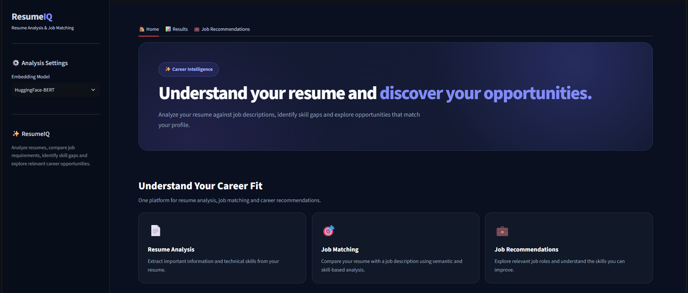
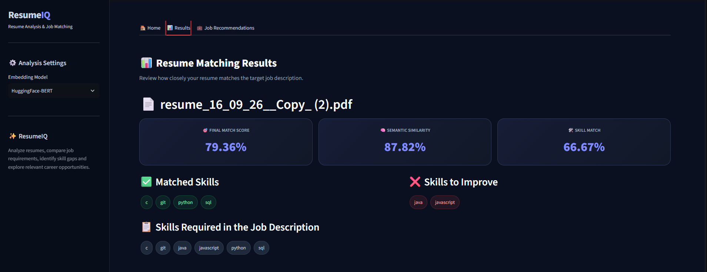
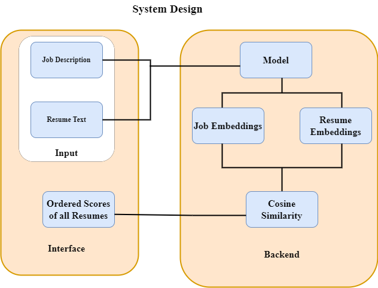

# ResumeMind — Smart ATS Checker: Resume-to-Job Matching System

[](https://www.python.org/)
[](https://streamlit.io/)
[](https://huggingface.co/)
[](https://pytorch.org/)
[](https://scikit-learn.org/)

An intelligent Natural Language Processing (NLP) and Deep Learning system designed to parse resumes, evaluate candidate compatibility against job descriptions using transformer embeddings, extract technical competencies, detect skill gaps, and recommend optimal career opportunities.

---

## 1. Academic Project Overview

**Smart ATS Checker: Resume-to-Job Matching System** is an end-to-end Machine Learning and Deep Learning system developed for academic research in career intelligence and information retrieval. By evaluating candidate resumes against target job descriptions using both deep semantic understanding (BERT bidirectional sentence embeddings) and granular technical skill matching, the system delivers accurate compatibility scores, actionable skill gap insights, and intelligent job recommendations.

The system features an interactive, dark-themed **Streamlit** dashboard as well as a scriptable **CLI mode** for automated screening.

---

## 2. Problem Statement

Traditional keyword-based Applicant Tracking Systems (ATS) frequently fail in real-world recruitment due to:

1. **Keyword Rigidity**: Candidates with equivalent experience might use synonyms (e.g., "Deep Learning" vs. "Neural Networks") that simple string matching misses.
2. **Lack of Context**: Simple keyword counts ignore semantic context, project depth, and relevance.
3. **No Actionable Feedback**: Job seekers rarely receive concrete feedback explaining why their resume did not match or which specific technical skills they need to acquire.
4. **Disjointed Job Discovery**: Candidates must manually search through hundreds of job listings to identify roles matching their specific skill set.

**Smart ATS Checker** solves this by combining transformer-based contextual semantic similarity with explicit technical skill extraction, providing transparent hybrid scoring and automated job matching.

---

## 3. Key Features

- 📄 **Multi-Resume Document Ingestion**: Extracts text seamlessly from single or multiple candidate resume PDFs or text files using `pdfplumber`.
- 🧠 **Contextual BERT Embeddings**: Computes 768-dimensional document embeddings using `sentence-transformers/bert-base-nli-mean-tokens` with attention-weighted mean pooling.
- 🛠️ **Automated Technical Skill Extraction**: Scans resume and job description text for 45+ technical competencies spanning programming languages, ML/DL frameworks, databases, and cloud platforms.
- 🎯 **Hybrid Compatibility Scoring**: Combines **60% Semantic Similarity** (Cosine Distance) with **40% Technical Skill Overlap** to ensure holistic matching.
- 📊 **Granular Skill Gap Analysis**: Categorizes skills into **Matched Skills** (strengths) and **Skills to Improve** (missing prerequisites).
- 💼 **Intelligent Job Recommendation**: Evaluates candidate profiles against a database of open roles and ranks matching opportunities.
- 🖥️ **Modern Interactive UI**: High-performance Streamlit interface with responsive dark mode cards, real-time feedback, and tabbed navigation.
- ⚡ **CLI Automation**: Supports direct command-line execution for rapid batch resume evaluation.
- 📚 **Interactive Learning Notebooks**: 4 well-documented Jupyter notebooks covering data exploration, preprocessing, model embeddings, and matching algorithms.
- 📑 **Comprehensive Academic Project Report**: Detailed academic documentation located in `reports/PROJECT_REPORT.md` suitable for university and capstone project submissions.

---

## 4. System Architecture & Workflow

```text
       Candidate Resume (PDF / TXT)           Target Job Description (Text)
                  │                                           │
                  ▼                                           ▼
       Document Text Extraction                   Text Sanitization & Ingestion
                  │                                           │
                  ├─────────────────────┬─────────────────────┤
                  │                     │                     │
                  ▼                     ▼                     ▼
      HuggingFace BERT Model    Skill Extractor       Doc2Vec Engine (Optional)
      (Mean-Pooled Embeddings)  (Regex Boundary)      (Dense Document Vectors)
                  │                     │                     │
                  ▼                     ▼                     │
          Cosine Similarity        Skill Overlap              │
           (Semantic Score)        (Skill Score)              │
                  │                     │                     │
                  └──────────┬──────────┘                     │
                             │                                │
                             ▼                                │
                  Hybrid Compatibility Score ◄────────────────┘
                 (60% Semantic + 40% Skill)
                             │
             ┌───────────────┴───────────────┐
             │                               │
             ▼                               ▼
    Candidate Matching Report        Job Recommendation Engine
   - Final Match Percentage         - Matches Against Database (jobs.csv)
   - Matched vs Missing Skills      - Ranked Fit Scores & Recommendations
   - Skill Gap Improvement Plan     - Candidate Readiness Assessment
```

---

## 5. Technology Stack

| Layer | Technologies |
| :--- | :--- |
| **Core Language** | Python 3.10 / 3.11 / 3.12 / 3.13 |
| **NLP & Deep Learning** | Hugging Face Transformers, PyTorch, NLTK, Gensim (Doc2Vec) |
| **Machine Learning** | Scikit-Learn (`cosine_similarity`), NumPy, Pandas |
| **Document Processing** | `pdfplumber` |
| **Web Framework & UI** | Streamlit |
| **Testing & Quality** | `unittest`, `pytest` |

---

## 6. Mathematical Formulation

### 1. BERT-Based Sentence Embeddings & Attention Mean Pooling
Token embeddings from BERT's final hidden state are aggregated into a single document-level vector using attention-weighted mean pooling:

$$\mathbf{u} = \frac{\sum_{i=1}^{N} \mathbf{h}_i \cdot m_i}{\sum_{i=1}^{N} m_i}$$

Where $\mathbf{h}_i$ is the $i$-th token representation and $m_i \in \{0, 1\}$ is the attention mask indicating non-padding tokens.

### 2. Cosine Semantic Similarity
Semantic similarity between the resume vector $\mathbf{u}$ and the job description vector $\mathbf{v}$ is calculated as:

$$\text{Semantic Score} = \left( \frac{\mathbf{u} \cdot \mathbf{v}}{\|\mathbf{u}\| \|\mathbf{v}\|} \right) \times 100$$

### 3. Technical Skill Overlap
The skill match percentage is calculated as:

$$\text{Skill Score} = \left( \frac{|\text{Resume Skills} \cap \text{JD Skills}|}{|\text{JD Skills}|} \right) \times 100$$

### 4. Hybrid Compatibility Formula

$$\text{Final Match Score} = (0.60 \times \text{Semantic Score}) + (0.40 \times \text{Skill Score})$$

---

## 7. Project File Structure

```text
Smart-ATS-Checker/
├── app.py                      # Main Streamlit web application & CLI entrypoint
├── requirements.txt            # Project dependencies
├── README.md                   # Comprehensive project documentation
├── DOCUMENTATION.md            # In-depth technical architecture manual
├── run.bat                     # Windows one-click launcher
├── .gitignore                  # Git ignore rules for Python & OS files
│
├── src/                        # Modular Deep Learning and NLP source code
│   ├── __init__.py             # Package exports & version metadata
│   ├── models.py               # BERT model caching, mean pooling, cosine similarity
│   ├── resume_parser.py        # PDF & text file extraction functions
│   ├── skill_extractor.py      # Technical skills catalog & regex extraction
│   ├── resume_scanner.py       # Hybrid resume-JD comparison engine
│   ├── job_recommender.py      # Dataset-driven job recommendation logic
│   └── utils.py                # Cross-platform path resolution helpers
│
├── data/                       # Datasets and benchmark test cases
│   ├── jobs.csv                # Job listings dataset (Role, Company, Description)
│   ├── sample_resumes/         # Benchmark test resumes
│   │   ├── machine_learning_engineer_resume.txt
│   │   ├── data_analyst_resume.txt
│   │   └── fullstack_developer_resume.txt
│   └── sample_jobs/            # Benchmark target job descriptions
│       ├── machine_learning_engineer_jd.txt
│       └── python_developer_jd.txt
│
├── notebooks/                  # Educational Jupyter Notebooks
│   ├── 01_data_exploration.ipynb
│   ├── 02_text_preprocessing.ipynb
│   ├── 03_model_exploration.ipynb
│   └── 04_resume_job_matching.ipynb
│
├── reports/                    # Academic Project Reports
│   ├── PROJECT_REPORT.md       # Comprehensive academic project report
│   └── EXECUTIVE_SUMMARY.md    # Two-page academic project summary
│
├── assets/
│   └── screenshots/            # UI screenshots for documentation
│       ├── home_page.png
│       ├── analysis_results.png
│       └── workflow.png
│
└── tests/
    ├── __init__.py
    └── test_core.py            # Unit & integration test suite (unittest / pytest)
```

---

## 8. Installation and Local Setup

### Prerequisites
- Python 3.10, 3.11, or 3.12 recommended
- Git (optional)

### 1. Set Up Virtual Environment

**On Windows (PowerShell):**
```powershell
python -m venv .venv
.\.venv\Scripts\Activate.ps1
```

**On Windows (Command Prompt):**
```cmd
python -m venv .venv
.\.venv\Scripts\activate.bat
```

**On macOS / Linux:**
```bash
python3 -m venv .venv
source .venv/bin/activate
```

### 2. Install Dependencies
```bash
pip install --upgrade pip
pip install -r requirements.txt
```

---

## 9. How to Run the Application

### Option A: Launch Interactive Web Application
```bash
streamlit run app.py
```
*The web interface will open automatically in your browser at `http://localhost:8501`.*

### Option B: Run via Command-Line Interface (CLI)
Compare a resume against a job description text file directly:
```bash
python app.py data/sample_resumes/machine_learning_engineer_resume.txt data/sample_jobs/machine_learning_engineer_jd.txt
```

### Option C: Run Automated Tests
```bash
python -m unittest discover -s tests
```

---

## 10. Educational & Research Notebooks

The `notebooks/` directory contains 4 educational Jupyter notebooks:

| Notebook | Topic | Description |
| :--- | :--- | :--- |
| `01_data_exploration.ipynb` | Data Analysis | Explores the job catalog, required skills, and distributions. |
| `02_text_preprocessing.ipynb` | NLP Preprocessing | Demonstrates PDF parsing with `pdfplumber` and regex skill extraction. |
| `03_model_exploration.ipynb` | Deep Learning | Explores BERT tokenization, attention masks, mean pooling, and Doc2Vec. |
| `04_resume_job_matching.ipynb` | Matching Engine | Demonstrates cosine similarity, skill matching, hybrid score, and recommendations. |

---

## 11. Screenshots

### Home Screen & Resume Upload


### Resume Matching & Skill Gap Results


### System Architecture & Workflow


---

## 12. Academic Project Report

A detailed, publication-ready Academic Project Report has been prepared for university submission:
- **Comprehensive Project Report**: [`reports/PROJECT_REPORT.md`](reports/PROJECT_REPORT.md)
- **Executive Summary**: [`reports/EXECUTIVE_SUMMARY.md`](reports/EXECUTIVE_SUMMARY.md)

---

## 13. Project Contributors

| Name | Roll Number | GitHub Profile | Academic Role & Affiliation |
| :--- | :--- | :--- | :--- |
| **Nimmagadda Harsha Vardhan** | `2023BCS0158` | [@harsha9625](https://github.com/harsha9625) | Deep Learning Modeling & Architecture • IIIT Kottayam (`nimmaga23bcs158@iiitkottayam.ac.in`) |
| **Konda Tej Akhilesh** | `2023BCS0160` | [@tejakhileshkonda-ops](https://github.com/tejakhileshkonda-ops) | NLP Pipeline & Skill Extraction • IIIT Kottayam (`konda23bcs160@iiitkottayam.ac.in`) |
| **K Sai Nihal** | `2023BCD0045` | Student Contributor | Evaluation & UI Architecture • IIIT Kottayam (`kandima23bcd45@iiitkottayam.ac.in`) |

---

## 14. Acknowledgements

- **Pretrained Deep Learning Models**: [Hugging Face sentence-transformers](https://huggingface.co/sentence-transformers/bert-base-nli-mean-tokens)
- **Deep Learning Framework**: [PyTorch](https://pytorch.org/)
- **NLP Libraries**: [Transformers](https://huggingface.co/), [NLTK](https://www.nltk.org/), [Gensim](https://radimrehurek.com/gensim/)
- **UI Platform**: [Streamlit](https://streamlit.io/)

